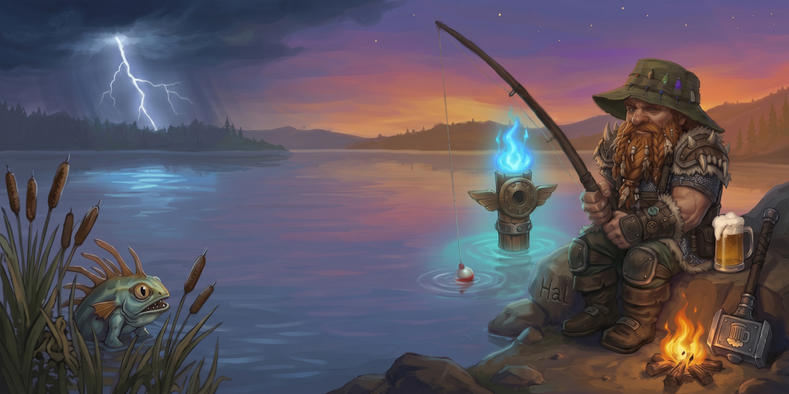

# R.E.E.L.: A Fishing Addon

Cast, and the interface fades out. Names, nameplates, combat text and tooltips go with it. Graphics go up. What's left is Forever's water, your bobber and one small bar with exactly what you need. We removed everything. Except your fishing line, you'll want that.

While you fish, R.E.E.L. writes it all down. Every catch goes in your journal with where and when you caught it, the rare ones light up in Records, and each zone shows the fish you're still missing. If you want to see how you stack up, you can paste it on halsudsworth.com.

For World of Warcraft: Forever only.

## Clean View and immersion

- **Clean View:** the whole UI fades while you fish. Keep the bar, loot window, chat or minimap if you want them. It comes back when you walk off, unequip your pole, hit Escape or click Show UI, and instantly if anything attacks you.
- **Immersion:** hide names, nameplates, combat text, error messages and the bobber tooltip. Auto-loot, so no loot window. Max graphics while you fish, your own settings after.
- **Sound:** music and ambience down, effects up, chatter muted.
- **Cinematic:** a fishing camera angle and letterbox bars.
- These start off. Pick a preset on the General page (Just the bar, Clean, Full immersion).

## At the water

- **Lures:** one-click button for your best lure or the one you choose. Timer on the bar, red before it runs out.
- **Buffs:** food and camp timers, "No food" and "No lure" reminders, Luremaster bonus fish counted.
- **One key:** bind Fish once. It puts on a lure, casts, and reels in when the bobber goes.
- **Cooking:** recipes on fish tooltips, with the vendor and zone to buy them.

## The journal

- **Every catch:** logged per character with time, zone and skill. Fish, zones, sessions and records.
- **Records:** the 1 Ring, the bloated fish, the wreckage trunks, the Stranglethorn rares. Feats for fishing every zone and finishing one.
- **Derby:** a Speckled Tastyfish counter during the Extravaganza, and your Master Angler wins kept.

## Leaderboards and events

R.E.E.L. comes with a website, [halsudsworth.com](https://halsudsworth.com), run by Hal Sudsworth, the angler who made it. Type `/reel export`, copy the text and paste it there, and your catches count toward:

- **Events all year:** the First cast tour, the Loch Frenzy race, the Winter Veil feast, Da Big Catch, Man vs. machine, the Feralas cook-off, Hallow's feud and more, each with its own place, fish and rules.
- **Challenges:** a new daily and weekly challenge.
- **Leaderboards:** for every zone. Hal reads the top ten himself.
- **Your character:** a page with its records, trophies and a tier list of every zone you've fished.

No account needed. Nothing leaves your game unless you paste it.

## Setup

Install from CurseForge or Wago, or drop the `Reel` folder into `Interface\AddOns`. `/reel` opens the settings (`/reelfish` if another addon uses `/reel`).

## Reporting a bug

Open an issue on GitHub. Before you do, type `/reel debug` in game and then `/reload`; that writes what the client reported about your fishing skill, lures and buffs into `WTF\Account\<account>\SavedVariables\Reel.lua`. Paste only its `["debug"]` block into the issue, along with any error text, and say which preset or toggles you had on. Don't attach the whole file: it holds your characters' ids, which let anyone replace their journals on the site.

## License

Copyright (c) 2026 Hal Sudsworth. All rights reserved. See [LICENSE](LICENSE).
