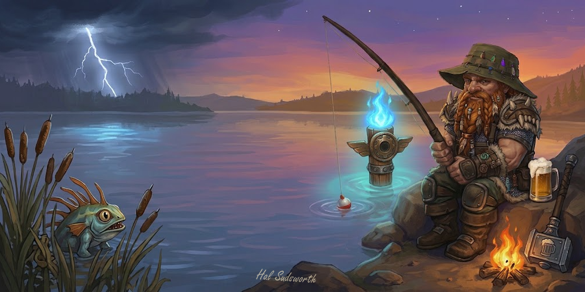

# R.E.E.L.: A Fishing Addon

Every fishing addon gives you a lure button and a catch log. R.E.E.L. gives you those, then clears everything else off your screen. Cast, and the interface fades out. Names, nameplates, combat text and tooltips go with it. Graphics go up. What's left is Forever's water, your bobber and one small bar with exactly what you need. We removed everything. Except your fishing line, you'll want that.

For World of Warcraft: Forever only.

## The toolkit

- **Lures:** one-click button that picks your best lure, or the one you choose. Lure timer on the bar, red warning before it runs out.
- **Buffs:** food and camp buff timers, "No food" and "No lure" reminders, Luremaster bonus fish counted.
- **One key:** bind Fish once. It applies a lure if your pole has none, casts, and reels in when the bobber goes. Or double-click the water to cast. Keybinds for the lure and the window too.
- **Journal:** every catch logged per character. Fish, zones, sessions, records, and which fish in this zone you're still missing.
- **Records:** the catches worth bragging about, lit up with date and zone when you land them. The 1 Ring, the bloated fish, the wreckage trunks, the Stranglethorn rares, Whimsyfin. Feats for fishing every zone and finishing one. Lifetime derby coins.
- **Cooking:** recipes on fish tooltips, with the vendor and zone to buy them.
- **Sound:** splash booster. Music and ambience off, effects up, chatter muted, so the splash is the only thing you hear.
- **Derby:** a Speckled Tastyfish counter for the Stranglethorn Fishing Extravaganza, shown while the contest runs.
- **The bar:** skill and cap with bonus, lure, food, camp, zone fish count. One line, any size you like. Nothing pops up, nothing plays a sound.

## The part nobody else does

- **Clean View:** the whole UI fades while you fish. Keep the bar, loot window, chat or minimap if you want them. Bring it back your way: start walking, unequip your pole, hit Escape, or click the Show UI button. If anything attacks you, it's back instantly.
- **Immersion:** hide floating names and nameplates, combat text and error messages, the bobber tooltip. Auto-loot so there's no loot window. Max graphics while you fish, back to your settings after.
- **Cinematic:** an optional fishing camera angle and letterbox bars.

## Setup

Install from CurseForge or Wago, or drop the `Reel` folder into `Interface\AddOns`. Type `/reel`. The toolkit is on by default; pick a preset on the General page (Just the bar, Clean, Full immersion) and tweak from there.

## Reporting a bug

Open an issue on GitHub. Before you do, type `/reel debug` in game and then `/reload`; that writes what the client reported about your fishing skill, lures and buffs into `WTF\Account\<account>\SavedVariables\Reel.lua`. Attach that file to the issue along with any error text, and say which preset or toggles you had on.

## License

Copyright (c) 2026 Hal Sudsworth. All rights reserved. See [LICENSE](LICENSE).
